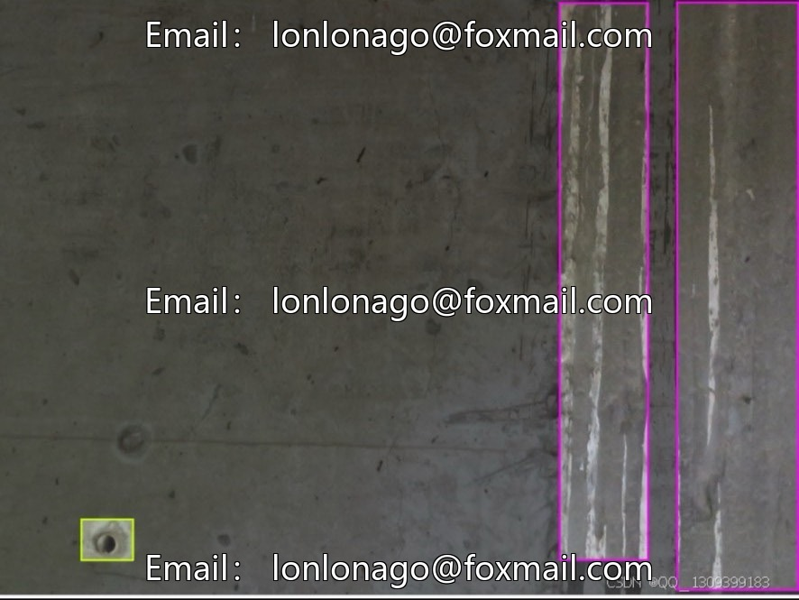
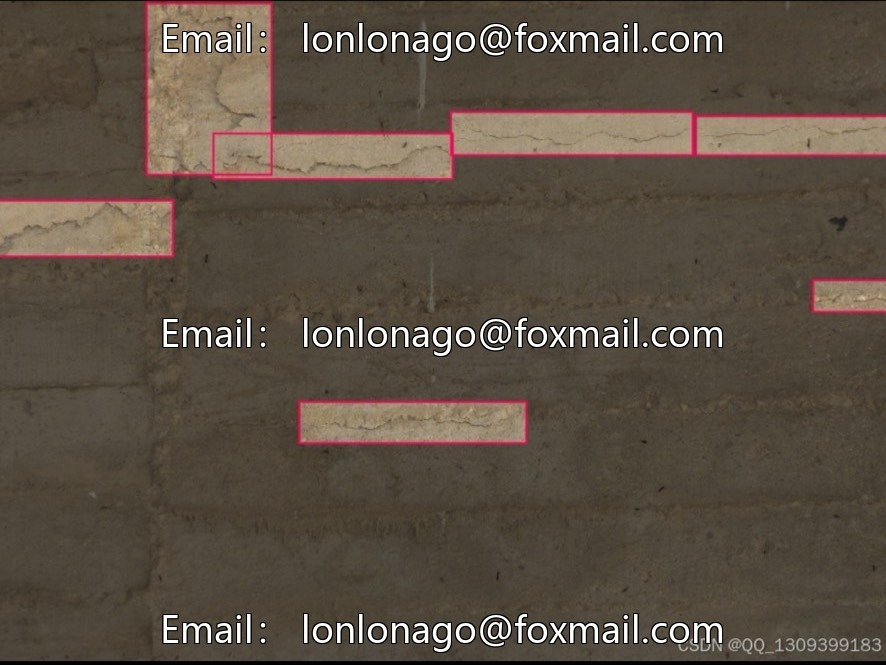
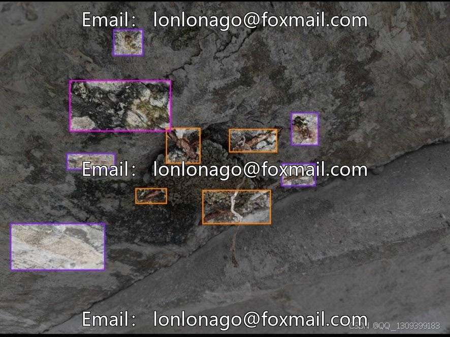
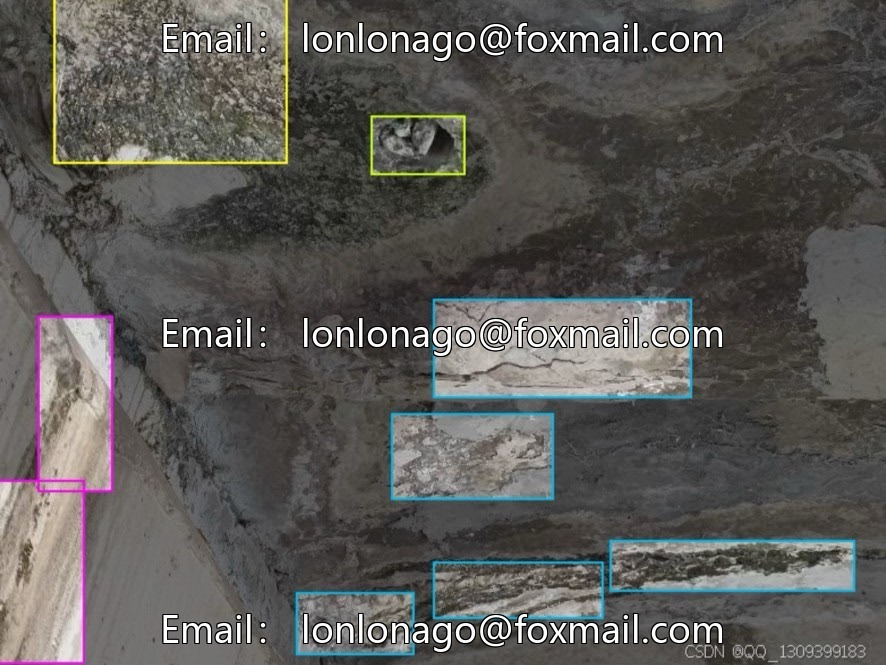
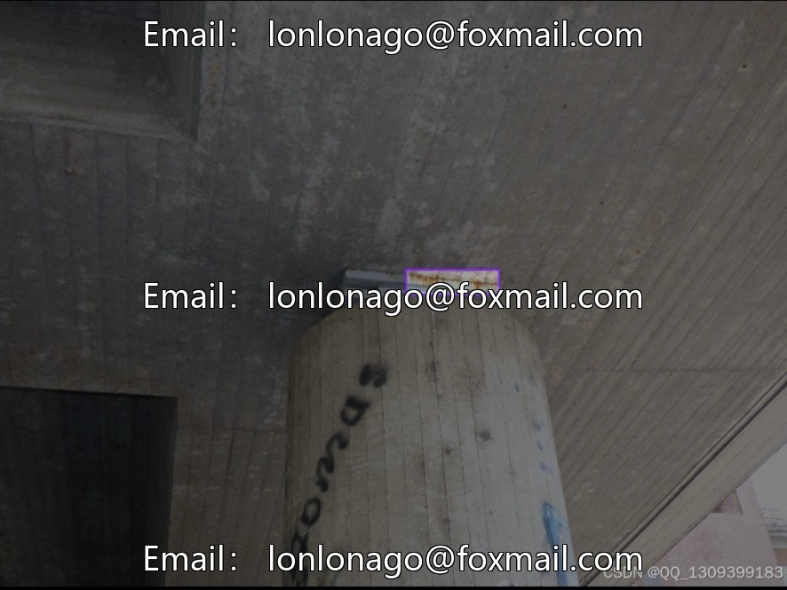
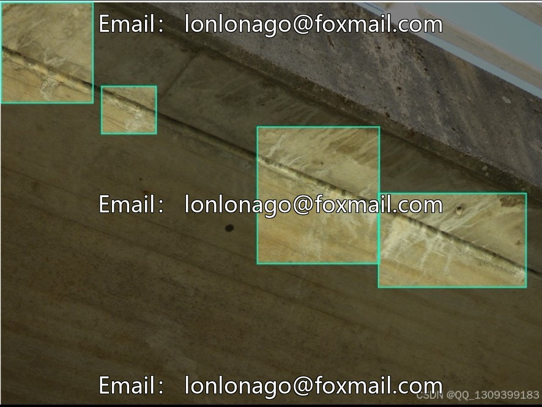

# Drone Bridge Defect Detection Dataset | Issue 10046

## Body

UAV Bridge Defect Detection Dataset | Issue 10046
Designed specifically for drone bridge inspections, concrete bridge disease target detection, and automatic recognition of various structural damages.

Basic scale: 919 real-scene images, multi-angles and lighting, to match the actual working conditions of field inspection, meeting the needs of basic model training.

Eight Major Defect Labeling Categories
1. Cavity: Holes on the surface
2. CorrosionStain: Rust stains and corrosion
3. Crack: Various types of cracks
4. Efflorescence: Bleaching and scaling
5. ExposedBars: Bars exposed in concrete
6. Spallation: Concrete spalling
7. Void: Internal voids
8. Water: Water accumulation and seepage

Dataset splitting rules: There is no official fixed ratio. Common industry practices include 8:2, 7:1:2 for training/validation/testing sets. The training set focuses on learning the subtle textures of diseases, the validation set adjusts parameters to prevent overfitting, and the testing set evaluates the model's generalization ability.

Image resolution: mainstream 640×480, 1280×720. Capable of capturing minor defects such as fine cracks and slight rusting, suitable for long-range aerial photography defect recognition.

Landing application scenarios
1. Long-term structural health monitoring of bridges: drone automatic inspection, replacing manual climbing for various damage investigations.
2. Construction Quality Acceptance of New Bridges: Identification of construction defects such as casting voids, surface peeling, and exposed rebar.
3. Maintenance and repair planning: Statistically analyze the distribution of diseases and the extent of damage, prioritizing maintenance in high-risk areas.
4. Civil Engineering and Computer Vision Academic Research: Bridge Damage Detection Algorithm Training and Comparative Test Materials

Virtual materials, once sold, are non-refundable.
Interested friends, click "I want" to proceed.

## Images

## Payment

Here is a pay link on Stripe ( https://buy.stripe.com/3cs8yP7sY87d0vu9AB ). Please contact me lonlonago@foxmail.com after funding $89, and I will send you a complete data files , thank you!

